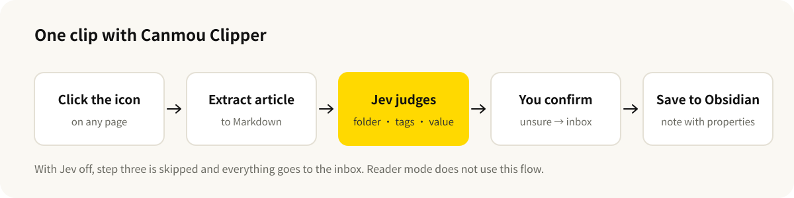

# Canmou Clipper


English · [中文](README.md)

[](https://github.com/baocanmou/canmou-clipper/releases/latest)
[](LICENSE)

[](https://gitee.com/baocanmou/canmou-clipper)

A Chrome extension for people who collect reference material in Obsidian: one click saves the article as a note, and Jev judges which folder it belongs in, which tags apply and how useful it is to you. When Jev is unsure, the note goes to your inbox instead of a wrong folder.

Chinese name 参谋剪藏. Not yet on the Chrome Web Store; download it and load it manually. The interface is in Chinese.

## Who it is for

- **You want to save a good article without deciding where it goes.** Jev suggests the folder and tags; you glance at them and change what is wrong.
- **Your vault has a fixed folder structure.** Describe what each folder collects, and clips are filed by your rules.
- **The page is cluttered and you just want to read.** A shortcut opens reader mode: article only, with a choice of Chinese typefaces.
- **You do not want AI involved.** Turn Jev off and it becomes a small clipper that saves everything to the inbox and sends nothing anywhere.

## What it does

- **One-click clipping**: extracts the article as Markdown with title, source, author and publish date as properties, and saves it to Obsidian.
- **Folder judgment**: Jev picks one of your folders; if nothing fits or its confidence is low, the note goes to the inbox.
- **Tag and value judgment**: each tag you define is checked separately; reference value is rated high, medium or low against the one-line description of your work.
- **Editable before saving**: title, folder and tags can all be changed in the popup. Jev's answers are suggestions.
- **Reader mode**: removes navigation, ads and sidebars; Songti, Kaiti or Heiti type; adjustable size; Esc to exit.
- **Copy Markdown**: copies the finished note to the clipboard without opening Obsidian.
- **Import and export settings**: folder and tag rules can be exported and shared. The API key is never exported.

## Example

The article below is **fictional**.

| Clip popup | Reader mode |
|---|---|
|  |  |

The saved note starts like this:

```markdown
---
title: "一家社区面馆如何靠一碗牛肉面做到日销800碗"
source: "https://example.com/article"
author: "李观察"
site: "餐饮观察"
published: 2026-09-28
clipped: 2026-10-03
value: 高
tags:
  - 剪藏
  - 案例
  - 方法
---
```

## What Jev does here

[Jev](https://docs.typesafe.ai) is TypeSafe's decision model. It does not generate text; it answers multiple-choice, yes/no and rating questions, and reports how confident it is. Canmou Clipper sends one request per clip with three kinds of question:

| Question | Type | How the answer is used |
|---|---|---|
| Which folder does this article belong in | One of many, including "none of these" | Used only at 50% confidence or above; otherwise the inbox |
| Does each tag apply | Yes/no, one question per tag | Tag is added at 60% probability or above |
| How valuable is it for your work | Four-level rating | Mapped to high, medium or low in the note properties |

So it never writes a summary and never invents content. Code controls the flow; Jev only supplies the judgments that require reading the article.



## Install

**Download**: get `canmou-clipper-<version>.zip` from [Releases](https://github.com/baocanmou/canmou-clipper/releases/latest) and unzip it.

**Or build it yourself** (Node.js 22 or later):

```bash
git clone https://github.com/baocanmou/canmou-clipper.git
```

```bash
cd canmou-clipper && npm ci && npm run build
```

In mainland China you can clone from `https://gitee.com/baocanmou/canmou-clipper.git` instead. The build output is the `dist` folder.

Then:

1. Open `chrome://extensions` and turn on Developer mode.
2. Click "Load unpacked" and choose the unzipped folder (or `dist` if you built it).
3. Click the extension icon, then 设置 (Settings). Enter your Obsidian vault name, and a TypeSafe API key if you want Jev's judgments.

## Usage

- **Clip**: on an article page, click the 参 icon in the toolbar or press `Alt+Shift+S`. Check the folder and tags, then click 存入 Obsidian. The browser asks once whether to open Obsidian; allow it.
- **Reader mode**: press `Alt+Shift+R`, or click 阅读模式 in the popup. Press it again or Esc to exit.
- **Filing rules**: in Settings, write one rule per line as `folder path | what belongs here`. The more specific the description, the better the judgment.

Shortcuts can be changed at `chrome://extensions/shortcuts`.

## Limits

- Jev's folder and tags are suggestions; check them before saving. Jev is trained mainly on English. It handles Chinese, but less consistently.
- Saving uses Obsidian's `obsidian://` link and the clipboard. It needs Obsidian 1.7.2 or later on the same computer, and it replaces whatever was on the clipboard.
- Image files are not saved; images in the note still point to the original site.
- Pages behind a login, browser built-in pages and web store pages may not be extractable.
- There is no chat, summary, highlighting or templating. That is deliberate.
- Verified on Chrome only.

## FAQ

**Does it work without an API key?** Yes. Clipping, reader mode and Copy Markdown do not depend on Jev. Everything goes to the inbox and you choose the folder and tags yourself.

**Where is my article sent?** Only when Jev is enabled: the title, description and roughly the first 6,000 characters of the article go to TypeSafe's API. See the [privacy notes](PRIVACY.md) (in Chinese).

**Why did an article land in the inbox?** Jev found no suitable folder, or its confidence was under 50%. Make the folder descriptions more specific, or add a folder for that topic.

**Will a note with the same name be overwritten?** No. Obsidian saves a second copy with a number appended.

## Versions

Current version **0.1.0**. Changes are listed in [Releases](https://github.com/baocanmou/canmou-clipper/releases).

To work on the code:

```bash
npm run check
```

This runs the type check, unit tests and build. Source is in `src/`, static files in `static/`, and the version number lives only in `package.json`.

## License and credits

[MIT](LICENSE). Article extraction uses [Defuddle](https://github.com/kepano/defuddle) (MIT). The product idea draws on [Obsidian Web Clipper](https://github.com/obsidianmd/obsidian-clipper) and [Qiaomu Clipper](https://github.com/joeseesun/qiaomu-clipper); the code is written independently.

## Other BaoCanMou open-source projects

| Project | What it does | China mirror |
|---|---|---|
| [Ad Compliance Check](https://github.com/baocanmou/obsidian-ad-compliance-check) | Obsidian plugin: flags risky advertising claims under Chinese ad law as you write | [Gitee](https://gitee.com/baocanmou/obsidian-ad-compliance-check) |
| [GEO Writing Check](https://github.com/baocanmou/obsidian-geo-writing-check) | Obsidian plugin: checks whether an article is easy for AI search to understand and cite | [Gitee](https://gitee.com/baocanmou/obsidian-geo-writing-check) |
| [Platform Ready Check](https://github.com/baocanmou/obsidian-platform-ready-check) | Obsidian plugin: checks a note against Chinese publishing platforms and keeps its sign-off current | [Gitee](https://gitee.com/baocanmou/obsidian-platform-ready-check) |
| [Restaurant Slogans: 10 Methods, 3 Picks](https://github.com/baocanmou/baocanmou-restaurant-slogan) | One restaurant tagline per method from ten masters, then three recommendations | [Gitee](https://gitee.com/baocanmou/baocanmou-restaurant-slogan) |
| [Plans into Presentations](https://github.com/baocanmou/baocanmou-plan-to-ppt) | Turns briefs and research into an editable, source-checked proposal deck | [Gitee](https://gitee.com/baocanmou/baocanmou-plan-to-ppt) |
| [BCM GEO Outcome Engine](https://github.com/baocanmou/bcm-geo-optimizer) | Diagnoses brand mentions, citations and recommendations in AI search | [Gitee](https://gitee.com/baocanmou/bcm-geo-optimizer) |
| [Open GEO SEO Console](https://github.com/baocanmou/open-geo-seo-console) | Self-hosted SEO and GEO monitoring console | [Gitee](https://gitee.com/baocanmou/open-geo-seo-console) |
| [BaoCanMou AI Skill Center](https://github.com/baocanmou/baocanmou-ai-skill-center) | Desktop app that catalogs local AI skills and links them to AI tools | [Gitee](https://gitee.com/baocanmou/baocanmou-ai-skill-center) |

## About BaoCanMou

BaoCanMou (包参谋) — Nanchang BaoCanMou Brand Planning Co., Ltd. — is a brand strategy and design company founded in 2012 in Nanchang, Jiangxi, China. We provide brand positioning, logo and visual identity, packaging, brand space and communication content, mainly for restaurants, chain stores, packaged food and regional specialty brands. Founder: Yi Huiting. Website: [www.bcmsj.com](https://www.bcmsj.com).

We work positioning first, design second. These tools come from work we repeat in client projects; we write the judgment criteria down so AI can follow the same standard.
