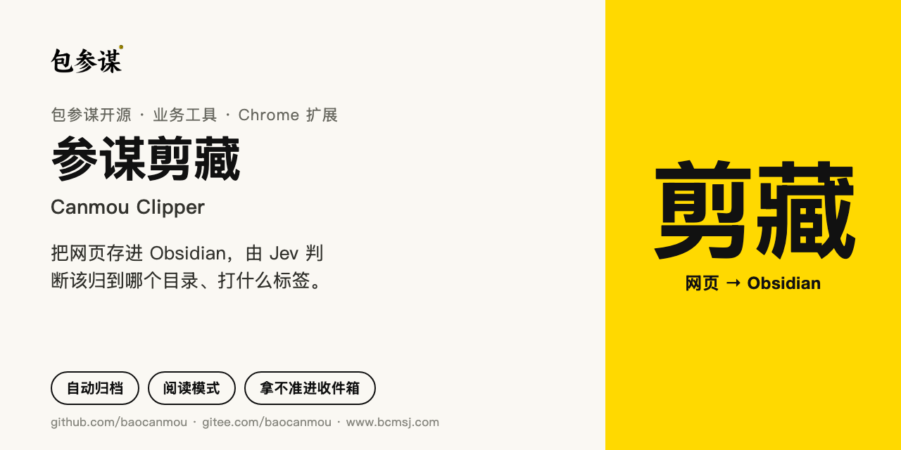
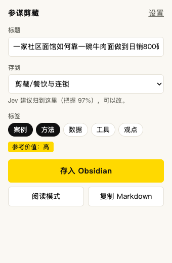
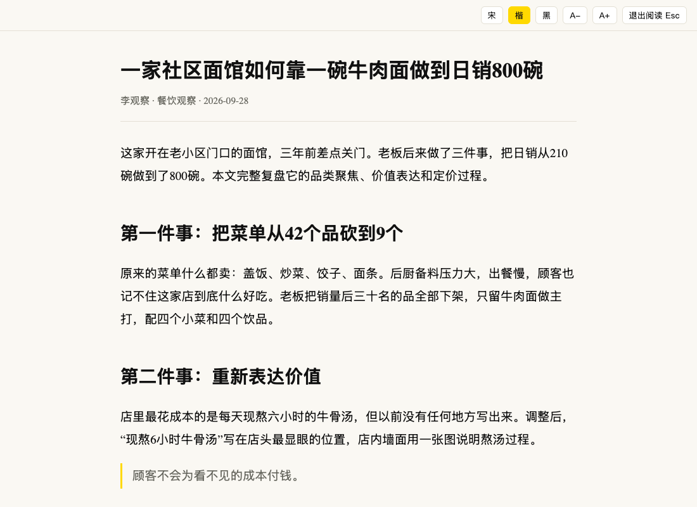
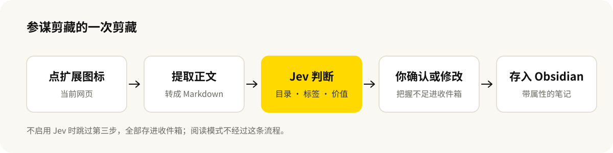

# 参谋剪藏



[English](README.en.md) · 中文

[](https://github.com/baocanmou/canmou-clipper/releases/latest)
[](LICENSE)

[](https://gitee.com/baocanmou/canmou-clipper)

一个 Chrome 扩展，给用 Obsidian 攒资料的人用：点一下把网页正文存成笔记，由 Jev 判断这篇该归到哪个目录、打什么标签、参考价值高低。拿不准的进收件箱，不乱放。

英文名 Canmou Clipper。尚未上架 Chrome 应用商店，需要下载后手动加载。

## 适合谁、什么时候用

- **看到好文章想存，但懒得想放哪**：目录和标签由 Jev 先给建议，你看一眼，不对就改。
- **资料库有固定的目录结构**：在设置里写清每个目录收什么，剪藏就按你的规矩归档。
- **网页广告多、排版乱，想安静读完**：按快捷键进入阅读模式，只留正文，中文字体可选。
- **不想用 AI**：关掉 Jev 判断，它就是一个只存收件箱的轻量剪藏工具，不向外发送任何内容。

## 能做什么

- **一键剪藏**：提取正文转成 Markdown，带标题、来源、作者、发布日期等属性，存进 Obsidian。
- **Jev 判断归档目录**：从你设置的目录里选一个；把握不足或没有合适目录时，放进收件箱。
- **Jev 判断标签和参考价值**：逐个判断你定义的标签是否适用；按你填写的职业背景给出高、中、低三档参考价值。
- **保存前可改**：标题、目录、标签都能在弹窗里调整，Jev 的结果只是建议。
- **阅读模式**：去掉导航、广告和侧栏，宋体、楷体、黑体可切换，字号可调，按 Esc 退出。
- **复制 Markdown**：不存 Obsidian，只把整理好的笔记复制到剪贴板。
- **配置导入导出**：目录和标签规则可以导出成文件，发给同事直接导入（不含密钥）。

## 效果示例

下面用的是一篇**虚构的**餐饮案例文章。

| 剪藏弹窗 | 阅读模式 |
|---|---|
|  |  |

存进 Obsidian 的笔记开头是这样的：

```markdown
---
title: "一家社区面馆如何靠一碗牛肉面做到日销800碗"
source: "https://example.com/article"
author: "李观察"
site: "餐饮观察"
published: 2026-09-28
clipped: 2026-10-03
value: 高
tags:
  - 剪藏
  - 案例
  - 方法
---
```

## Jev 在这里做什么

[Jev](https://docs.typesafe.ai) 是 TypeSafe 的判断型模型：它不生成文字，只回答选择题、是非题和打分题，并给出把握程度。参谋剪藏每次剪藏只发一次请求，同时问三类问题：

| 问题 | 类型 | 结果怎么用 |
|---|---|---|
| 这篇文章该放哪个目录 | 多选一，含“都不合适” | 把握达到 50% 才采用，否则进收件箱 |
| 每个标签是否适用 | 是非题，每个标签一题 | “是”的概率达到 60% 才打上 |
| 对你的工作有多大参考价值 | 四档评分 | 折算成高、中、低写进笔记属性 |

所以它不会替你写摘要，也不会编内容。流程由代码控制，Jev 只负责“这篇讲的是什么”这类需要读懂文章才能回答的判断。



## 安装

**直接下载**：到 [Releases](https://github.com/baocanmou/canmou-clipper/releases/latest) 下载 `canmou-clipper-版本号.zip` 并解压。

**或者自己构建**（需要 Node.js 22 或以上）：

```bash
git clone https://github.com/baocanmou/canmou-clipper.git
```

```bash
cd canmou-clipper && npm ci && npm run build
```

国内网络可以把克隆地址换成 `https://gitee.com/baocanmou/canmou-clipper.git`。构建结果在 `dist` 文件夹。

然后：

1. 打开 `chrome://extensions`，开启右上角“开发者模式”。
2. 点“加载已解压的扩展程序”，选择解压出来的文件夹（自己构建的选 `dist`）。
3. 点扩展图标，再点“设置”，填写 Obsidian 笔记库名称；要用 Jev 判断，再填 TypeSafe API 密钥。

## 使用方法

- **剪藏**：在文章页面点工具栏的“参”图标，或按 `Alt+Shift+S`。确认目录和标签后点“存入 Obsidian”。首次保存时浏览器会问是否打开 Obsidian，选允许。
- **阅读模式**：按 `Alt+Shift+R`，或在弹窗里点“阅读模式”。再按一次或按 Esc 退出。
- **调整归档规则**：在设置页的“归档目录”里每行写一条，格式是 `目录路径 | 什么内容该放这里`。说明越具体，判断越准。

快捷键可以在 `chrome://extensions/shortcuts` 里改。

## 边界

- Jev 的目录和标签是建议，保存前请看一眼。它以英文训练为主，中文内容也能判断，但准确度没有英文稳定。
- 保存通过 Obsidian 的 `obsidian://` 链接和剪贴板完成，需要本机装有 Obsidian 1.7.2 或以上；保存时会覆盖剪贴板里原有的内容。
- 不保存图片文件，笔记里的图片仍然指向原网页地址。
- 需要登录才能看的内容、浏览器内置页面、应用商店页面可能无法提取。
- 没有对话、摘要、划线、模板这些功能，这是有意的取舍。
- 只在 Chrome 上验证过。

## 常见问题

**不填密钥能用吗？** 能。剪藏、阅读模式、复制 Markdown 都不依赖 Jev，只是所有文章都进收件箱，目录和标签自己选。

**我的文章内容会发到哪里？** 只有启用 Jev 判断时，标题、摘要和正文开头约 6000 字会发给 TypeSafe 的接口。详见[隐私说明](PRIVACY.md)。

**为什么文章被放进了收件箱？** Jev 认为没有合适的目录，或把握不到 50%。可以把目录说明写得更具体，或增加一个对应的目录。

**同名笔记会被覆盖吗？** 不会。Obsidian 会在文件名后加序号另存一份。

## 版本与更新

当前版本 **0.1.0**。各版本的变化见 [Releases](https://github.com/baocanmou/canmou-clipper/releases)。

参与开发：

```bash
npm run check
```

依次执行类型检查、单元测试和构建。源码在 `src/`，静态文件在 `static/`，版本号只在 `package.json` 里维护。

## 许可与致谢

[MIT](LICENSE)。正文提取使用 [Defuddle](https://github.com/kepano/defuddle)（MIT）。产品形态参考了 [Obsidian Web Clipper](https://github.com/obsidianmd/obsidian-clipper) 和[乔木剪藏](https://github.com/joeseesun/qiaomu-clipper)，代码为独立编写。

## 包参谋其他开源项目

| 项目 | 做什么 | 国内镜像 |
|---|---|---|
| [发布前合规检查](https://github.com/baocanmou/obsidian-ad-compliance-check) | Obsidian 插件：写作时标出广告法风险表达，给出依据和改写建议 | [Gitee](https://gitee.com/baocanmou/obsidian-ad-compliance-check) |
| [GEO 写作检查](https://github.com/baocanmou/obsidian-geo-writing-check) | Obsidian 插件：检查文章是否便于 AI 搜索理解和引用 | [Gitee](https://gitee.com/baocanmou/obsidian-geo-writing-check) |
| [平台成稿检查](https://github.com/baocanmou/obsidian-platform-ready-check) | Obsidian 插件：按公众号、小红书等平台检查成稿，管理文末落款 | [Gitee](https://gitee.com/baocanmou/obsidian-platform-ready-check) |
| [餐饮广告语·十法三选](https://github.com/baocanmou/baocanmou-restaurant-slogan) | 按 10 种名家方法各写一条餐饮广告语，比较后推荐 3 条 | [Gitee](https://gitee.com/baocanmou/baocanmou-restaurant-slogan) |
| [策划资料变 PPT](https://github.com/baocanmou/baocanmou-plan-to-ppt) | 把简报和调研做成有来源、可编辑的提案 PPT | [Gitee](https://gitee.com/baocanmou/baocanmou-plan-to-ppt) |
| [GEO 效果优化](https://github.com/baocanmou/bcm-geo-optimizer) | 诊断品牌在 AI 搜索中的提及、引用和推荐，按证据排改进任务 | [Gitee](https://gitee.com/baocanmou/bcm-geo-optimizer) |
| [Open GEO SEO Console](https://github.com/baocanmou/open-geo-seo-console) | 可自行部署的 SEO 与 GEO 监控后台 | [Gitee](https://gitee.com/baocanmou/open-geo-seo-console) |
| [包参谋 AI 技能中心](https://github.com/baocanmou/baocanmou-ai-skill-center) | 盘点本机 AI Skill 并统一连接多种 AI 工具的桌面应用 | [Gitee](https://gitee.com/baocanmou/baocanmou-ai-skill-center) |

## 关于包参谋

包参谋，全称南昌包参谋品牌策划有限公司，2012 年创立于江西南昌，提供品牌定位、Logo/VI 设计、包装设计、品牌空间与传播内容服务，主要服务餐饮、连锁门店、食品快消和地方特色品牌。创始人易慧庭。官网：[www.bcmsj.com](https://www.bcmsj.com)。

我们先定位，后设计。这些开源工具来自我们在实际项目里反复做的工作，我们把判断标准写清楚，让 AI 按同样的标准做事。
